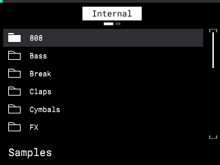
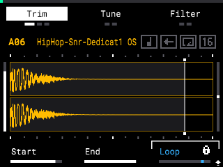
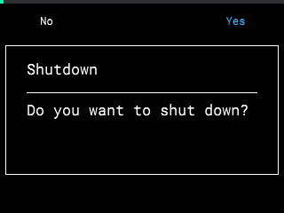
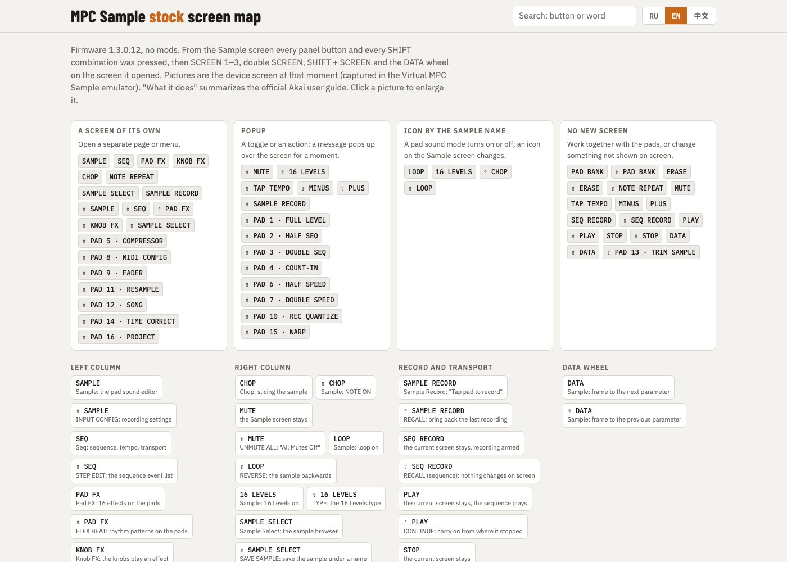

# Virtual MPC Sample

**English** · [Русский](README.ru.md) · [中文](README.zh-CN.md)

The stock firmware of the Akai MPC Sample (1.3.0.12) running unmodified in QEMU, with the
whole device in your browser: the top panel with the live screen, pads, knobs and buttons,
the rear panel with its jacks, the SD slot and USB-C. Works on macOS, Linux and Windows;
fastest on Apple Silicon.


| Factory library on `/content` | Trim page | Power key: the app asks | ...saves and powers off |
|---|---|---|---|
|  |  |  |  |

> **Unofficial project.** Not affiliated with, endorsed by or supported by inMusic Brands or
> Akai Professional. **No firmware and no factory content are in this repository**: you need
> your own copy of the firmware update and, for the factory library, your own MPC Sample.

## What it is for

- **Build and test mods without risking the device.** SD autorun packages run exactly as on
  the MPC (the firmware's own script runner); a broken package costs a `lab.py reset`, not a
  recovery.
- **Debug inside the stock app.** Root shell, `LD_PRELOAD` libraries, strace, the panel's
  raw control-surface bytes.
- **Learn the device.** [stock-map/](stock-map/README.md) is every stock screen, in English,
  Russian and Chinese, with what each button and SHIFT combination does there.

[](stock-map/README.md)

The stock screen map: 56 sections, 383 screenshots taken in this emulator, one offline HTML
page (open `stock-map/index.html`).

## What works

- The stock rootfs, byte-identical, opened through dm-verity with the stock root hash from
  the signed kernel image; the stock systemd units start the stock app.
- The 320×240 screen, pads, knobs, buttons and the data wheel through the same UART protocol
  the panel's microcontroller speaks.
- Sound in the browser page; sampling from the page's inputs.
- SD card (any folder on your computer), SD autorun packages, the factory library.
- USB-C: the device's own USB network (192.168.155.1), USB MIDI, root SSH for community
  packages.
- Power key as on the device: the app asks, saves the project, powers off.

Not yet: USB audio over USB-C, a Windows test run, other firmware versions. See the
[roadmap](#roadmap).

## Quick start

You need QEMU 9+, Docker (only for the build), Python 3.9+ and an OpenSSH client.

1. Clone the repository.
2. Put the firmware partitions in `firmware/extracted/` (git-ignored):
   `part1` (boot), `part2` (rootfs), `parr` (recovery), extracted from inMusic's
   `MPCSAMPLE-1.3.0.12-update.img`. The build checks them against `inputs.sha256`.
   This repository has no extractor for the update image yet
   ([details](docs/CUSTOM_FIRMWARE.md#4-another-stock-firmware-version)).
3. Build and run:

   ```bash
   python3 lab.py build    # Docker: kernel (~15 min once), audio bridge, disk images
   python3 lab.py run      # the VM; starts the panel too
   ```

4. Open **http://127.0.0.1:8765/** and click once for sound.

```bash
python3 lab.py ssh               # root shell in the VM
python3 lab.py autorun PKG.zip   # run an SD autorun package
python3 lab.py stop              # power key + "Yes": saves, shuts down, QEMU exits
python3 lab.py reset             # next start from a clean eMMC
```

On Windows use `py lab.py ...`. On macOS start the lab from Terminal.app or iTerm, not from
an IDE's or another app's terminal pane: macOS may throttle it, and the sound clicks.

## Documentation

| | |
|---|---|
| [docs/USAGE.md](docs/USAGE.md) | full guide: factory library, USB-C, SD autoruns, host requirements, ports |
| [docs/PANEL.md](docs/PANEL.md) | the virtual panel, its protocol, sound, the SD card |
| [docs/CUSTOM_FIRMWARE.md](docs/CUSTOM_FIRMWARE.md) | your own code: autorun packages, `LD_PRELOAD`, lab layer files, other firmware versions |
| [docs/MPC_SAMPLE_VIRTUAL_LAB_ARCHITECTURE.md](docs/MPC_SAMPLE_VIRTUAL_LAB_ARCHITECTURE.md) | what is known about the device and why the lab is built this way |
| [docs/POC_RESULTS.md](docs/POC_RESULTS.md) | measurements and the differences from the device that remain |
| [stock-map/](stock-map/README.md) | every stock screen, EN/RU/中文, one offline HTML page |

| Folder | Contents |
|---|---|
| `lab.py` | the whole lab: build, run, ssh, autorun, stop, selftest |
| `panel/` | the browser panel and its server (plays the panel MCU) |
| `kernel/` | lab kernel config and patches (mainline 6.12.60 PREEMPT_RT) |
| `overlay/` | the lab-only read-only layer over the stock rootfs |
| `bridge/`, `initramfs/`, `docker/` | audio bridge, lab initramfs, build container |
| `scripts/`, `tools/` | build scripts and host tools |

## Roadmap

Help is welcome on any of these:

- **Firmware extractor** for the `AZ0x` update image, so that setup is one command. The
  biggest barrier for new users today.
- **Windows and Linux runs.** The code paths exist; only macOS (Apple Silicon) has been run.
- **Prebuilt kernel and audio bridge** as release downloads, so no 15-minute Docker build.
- **CI** running `make test` (the lab and panel self-tests) on every pull request.
- **USB audio (UAC2)** on the emulated USB-C; it is left out because it cannot bind on the
  lab's USB controller.
- **Fewer audio clicks** under software emulation (TCG) and a tickless guest under HVF
  without the `nohz=off` cost.
- **Other firmware versions** and checks of what each one changes.
- **Host MIDI** in the panel page (Web MIDI to the rear MIDI jacks).

Open an issue before a large change. See [CONTRIBUTING.md](CONTRIBUTING.md).

## Built with Claude

This project was developed together with Claude, Anthropic's AI model,
in Claude Code. Claude wrote much of the code, the kernel
patches and the documentation, and ran most of the measurements in the VM. The author set
the goals, made the decisions, checked the results against a real MPC Sample and is
responsible for what is published here.

Treat it as you would any young project: read what you run. The figures in the docs were
measured on one Mac (Apple Silicon, firmware 1.3.0.12) on the dates given.

## Legal

- Akai Professional and MPC are trademarks of inMusic Brands, Inc. They are used here only
  to name the device the lab emulates.
- The lab only reads the firmware files you provide, mounts them read-only and never writes
  to a physical device.
- Screenshots of the stock app are shown for documentation and interoperability.

## License

[MIT](LICENSE), except `kernel/patches/`, which are patches to the Linux kernel and are
under GPL-2.0, as the kernel is.
