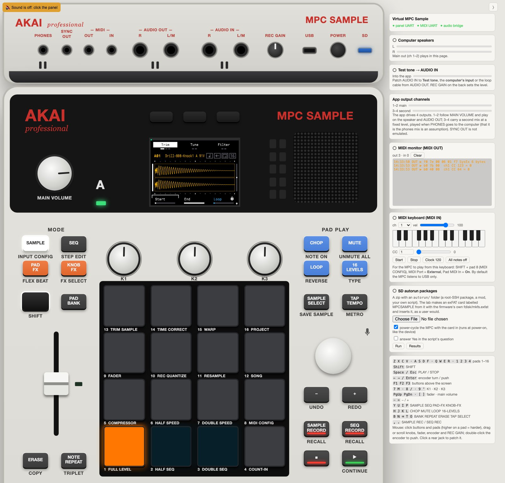

# Virtual MPC Sample

[English](README.md) · [Русский](README.ru.md) · **中文**

在 QEMU 中原样运行 Akai MPC Sample 的原厂固件（1.3.0.12），整台设备都在浏览器里：带实时屏幕、
打击垫、旋钮和按键的顶部面板，带各种接口的背板，SD 卡槽和 USB-C。支持 macOS、Linux 和
Windows；在 Apple Silicon 上速度最快。



| `/content` 上的出厂音色库 | Trim 页面 | 电源键：应用询问 | ……保存并关机 |
|---|---|---|---|
|  |  |  |  |

> **非官方项目。** 与 inMusic Brands 及 Akai Professional 无任何关联，也未获其认可或支持。
> **本仓库不包含任何固件和出厂内容**：你需要自己的固件更新文件；如需出厂音色库，还需要你自己的 MPC Sample。

## 用途

- **开发和测试改装（mod），不必拿设备冒险。** SD autorun 包的运行方式与真机完全相同（使用固件自带的
  脚本运行器）；包写坏了只需一次 `lab.py reset`，无需救砖。
- **在原厂应用内部调试。** root shell、`LD_PRELOAD` 库、strace、面板控制的原始字节。
- **了解设备。** [stock-map/](stock-map/README.md) 收录了所有原厂屏幕，提供英文、俄文和中文：每个按键和
  每个 SHIFT 组合键在各屏幕上的作用。

[](stock-map/README.md)

原厂屏幕地图：56 个章节、383 张在本模拟器中截取的截图，一个可离线打开的 HTML 页面
（打开 `stock-map/index.html` 即可）。

## 已实现的功能

- 原厂 rootfs 逐字节一致，通过 dm-verity 并使用签名内核镜像中的原厂 root hash 挂载；由原厂 systemd
  单元启动原厂应用。
- 320×240 屏幕、打击垫、旋钮、按键和 DATA 旋轮，使用与面板单片机相同的 UART 协议。
- 声音在浏览器页面中播放；可从页面的输入进行采样。
- SD 卡（电脑上的任意文件夹）、SD autorun 包、出厂音色库。
- USB-C：设备自带的 USB 网络（192.168.155.1）、USB MIDI、供社区包使用的 root SSH。
- 电源键与真机一致：应用询问、保存工程、关机。

尚未实现：通过 USB-C 的 USB 音频、Windows 上的实测、其他固件版本。见[路线图](#路线图)。

## 快速开始

需要 QEMU 9+、Docker（仅构建时需要）、Python 3.9+ 和 OpenSSH 客户端。

1. 克隆本仓库。
2. 将固件分区放入 `firmware/extracted/`（已被 git 忽略）：`part1`（boot）、`part2`（rootfs）、
   `parr`（recovery），均提取自 inMusic 的 `MPCSAMPLE-1.3.0.12-update.img`。构建时会用
   `inputs.sha256` 校验。本仓库暂时没有更新镜像的解包工具
   （[详情](docs/CUSTOM_FIRMWARE.md#4-another-stock-firmware-version)）。
3. 构建并运行：

   ```bash
   python3 lab.py build    # Docker：内核（首次约 15 分钟）、音频桥、磁盘镜像
   python3 lab.py run      # 虚拟机；面板也会一起启动
   ```

4. 打开 **http://127.0.0.1:8765/**，点击一次页面即可听到声音。

```bash
python3 lab.py ssh               # 虚拟机中的 root shell
python3 lab.py autorun PKG.zip   # 运行 SD autorun 包
python3 lab.py stop              # 电源键 + "Yes"：保存、关机、退出 QEMU
python3 lab.py reset             # 下次从干净的 eMMC 启动
```

Windows 上使用 `py lab.py ...`。macOS 上请从 Terminal.app 或 iTerm 启动，不要在 IDE 或其他应用的
终端面板中启动：macOS 可能会降低其优先级，导致声音出现爆音。

## 文档

详细文档为英文：

| | |
|---|---|
| [docs/USAGE.md](docs/USAGE.md) | 完整指南：出厂音色库、USB-C、SD autorun、主机要求、端口 |
| [docs/PANEL.md](docs/PANEL.md) | 虚拟面板、其协议、声音、SD 卡 |
| [docs/CUSTOM_FIRMWARE.md](docs/CUSTOM_FIRMWARE.md) | 运行你自己的代码：autorun 包、`LD_PRELOAD`、实验室层文件、其他固件版本 |
| [docs/MPC_SAMPLE_VIRTUAL_LAB_ARCHITECTURE.md](docs/MPC_SAMPLE_VIRTUAL_LAB_ARCHITECTURE.md) | 关于设备的已知信息，以及实验室为何如此设计 |
| [docs/POC_RESULTS.md](docs/POC_RESULTS.md) | 测量结果以及与真机仍存在的差异 |
| [stock-map/](stock-map/README.md) | 所有原厂屏幕，EN/RU/中文，一个 HTML 页面 |

| 目录 | 内容 |
|---|---|
| `lab.py` | 整个实验室：build、run、ssh、autorun、stop、selftest |
| `panel/` | 浏览器面板及其服务器（模拟面板单片机） |
| `kernel/` | 实验室内核配置和补丁（mainline 6.12.60 PREEMPT_RT） |
| `overlay/` | 叠加在原厂 rootfs 之上的只读实验室专用层 |
| `bridge/`、`initramfs/`、`docker/` | 音频桥、实验室 initramfs、构建容器 |
| `scripts/`、`tools/` | 构建脚本和主机工具 |

## 路线图

以下任何一项都欢迎贡献：

- **固件解包工具**，用于 `AZ0x` 更新镜像，让配置只需一条命令。这是目前新用户面临的最大障碍。
- **在 Windows 和 Linux 上运行。** 相关代码已存在，但只在 macOS（Apple Silicon）上实际运行过。
- **预编译的内核和音频桥** 作为 release 下载，省去 15 分钟的 Docker 构建。
- **CI**：在每个 pull request 上运行 `make test`（实验室和面板的自检）。
- **模拟 USB-C 上的 USB 音频（UAC2）**；目前未启用，因为它无法绑定到实验室的 USB 控制器上。
- **减少爆音**：软件模拟（TCG）下的爆音，以及在 HVF 下实现 tickless 客户机而不付出 `nohz=off` 的代价。
- **其他固件版本**，并核实每个版本的变化。
- **主机 MIDI**：在面板页面中通过 Web MIDI 连接背板 MIDI 接口。

较大的改动请先开 issue。参见 [CONTRIBUTING.md](CONTRIBUTING.md)。

## 与 Claude 共同开发

本项目是与 Anthropic 的 AI 模型 Claude 在 Claude Code
中共同开发的。Claude 编写了大部分代码、内核补丁和文档，并完成了虚拟机中的大部分测量。作者负责设定目标、
做出决策、在真实的 MPC Sample 上核对结果，并对此处发布的内容负责。

请像对待任何年轻项目一样对待它：运行之前先读一读代码。文档中的数据是在一台 Mac（Apple Silicon，
固件 1.3.0.12）上于标注的日期测得的。

## 法律声明

- Akai Professional 和 MPC 是 inMusic Brands, Inc. 的商标，此处仅用于指称本实验室所模拟的设备。
- 实验室只读取你提供的固件文件，以只读方式挂载，绝不写入实体设备。
- 原厂应用的屏幕截图仅用于文档和互操作目的。

## 许可证

[MIT](LICENSE)，`kernel/patches/` 除外：它们是 Linux 内核的补丁，与内核一样采用 GPL-2.0。
